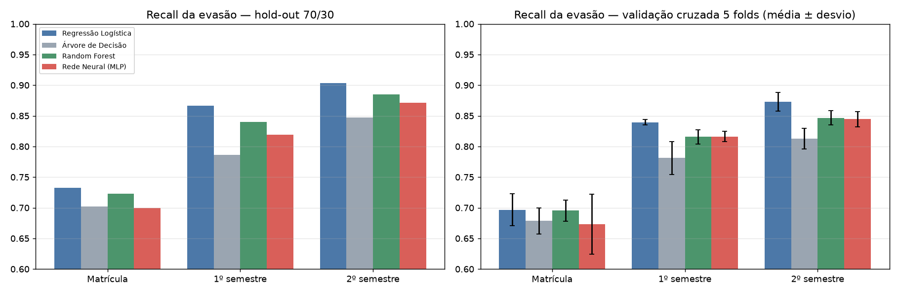
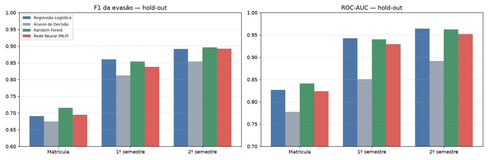
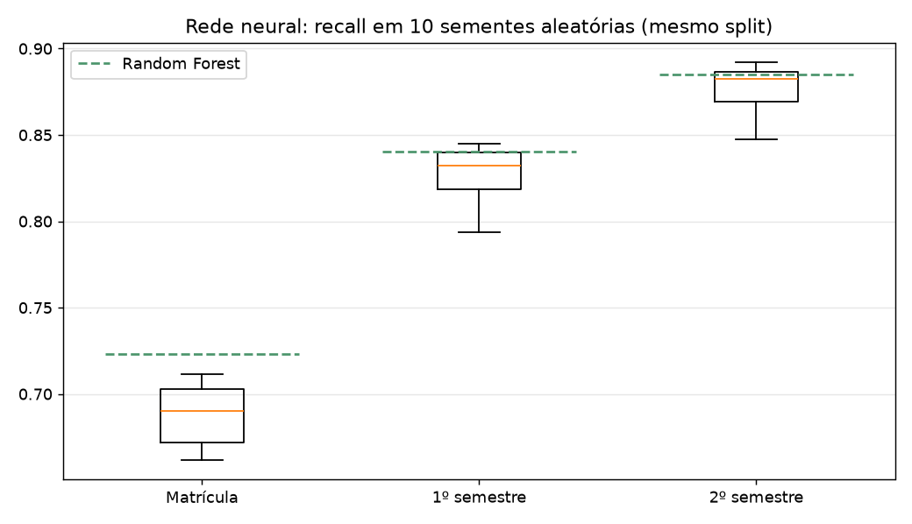

# Comparativo de desempenho — modelos clássicos × Rede Neural (MLP)

Compara os resultados dos notebooks [`projeto_evasao_escolar.ipynb`](../projeto_evasao_escolar.ipynb) (Regressão Logística, Árvore de Decisão, Random Forest) e [`projeto_evasao_escolar_mlp.ipynb`](../projeto_evasao_escolar_mlp.ipynb) (Rede Neural MLP).

## 1. Como a comparação foi feita

- **Os dois notebooks foram executados** do início ao fim, sem erros. Os números do hold-out abaixo **coincidem exatamente** com as tabelas dos notebooks.
- **Base:** 3.630 estudantes (1.421 evasões = 39,1%; 2.209 graduados = 60,9%). Teste: 1.089 estudantes (426 evasões).
- **Mesmo protocolo para os 4 modelos:** split 70/30 estratificado, `random_state=42`, `StandardScaler` ajustado só no treino.
- **Desbalanceamento:** modelos clássicos usam `class_weight="balanced"`; a MLP usa sobreamostragem da evasão no treino (não há `class_weight` no `MLPClassifier`).
- **Além do que os notebooks já mostram,** foram calculados, com o mesmo código: acurácia, ROC-AUC, tempo de treino, validação cruzada de 5 folds (scaler e sobreamostragem refeitos em cada fold) e 10 sementes diferentes para a MLP. Esses extras vieram de um script de comparação e **não estão nos notebooks**.
- **Métrica principal:** recall da evasão (falso negativo = aluno em risco sem acompanhamento).

---

## 2. Resultados no hold-out 70/30 (os mesmos dos notebooks)

Classe **evasão**. Em **negrito**, o melhor de cada coluna dentro do cenário.

### Matrícula (24 variáveis)

| Modelo | Precision | Recall | F1 | Acurácia | ROC-AUC | Falsos neg. | Falsos pos. | Treino (s) |
|---|---|---|---|---|---|---|---|---|
| Regressão Logística | 0,653 | **0,732** | 0,690 | 0,743 | 0,827 | **114** | 166 | **0,06** |
| Árvore de Decisão | 0,650 | 0,702 | 0,675 | 0,736 | 0,777 | 127 | 161 | 0,03 |
| Random Forest | **0,708** | 0,723 | **0,715** | **0,775** | **0,841** | 118 | **127** | 1,35 |
| Rede Neural (MLP) | 0,690 | 0,700 | 0,695 | 0,759 | 0,823 | 128 | 134 | 0,41 |

### 1º semestre (30 variáveis)

| Modelo | Precision | Recall | F1 | Acurácia | ROC-AUC | Falsos neg. | Falsos pos. | Treino (s) |
|---|---|---|---|---|---|---|---|---|
| Regressão Logística | 0,854 | **0,866** | **0,860** | **0,890** | **0,943** | **57** | 63 | **0,08** |
| Árvore de Decisão | 0,840 | 0,786 | 0,812 | 0,858 | 0,851 | 91 | 64 | 0,03 |
| Random Forest | **0,867** | 0,840 | 0,853 | 0,887 | 0,940 | 68 | **55** | 1,36 |
| Rede Neural (MLP) | 0,857 | 0,819 | 0,838 | 0,876 | 0,929 | 77 | 58 | 0,92 |

### 2º semestre (36 variáveis)

| Modelo | Precision | Recall | F1 | Acurácia | ROC-AUC | Falsos neg. | Falsos pos. | Treino (s) |
|---|---|---|---|---|---|---|---|---|
| Regressão Logística | 0,879 | **0,904** | 0,891 | 0,914 | **0,964** | **41** | 53 | **0,07** |
| Árvore de Decisão | 0,860 | 0,847 | 0,853 | 0,886 | 0,892 | 65 | 59 | 0,03 |
| Random Forest | 0,908 | 0,885 | **0,897** | **0,920** | 0,962 | 49 | 38 | 1,33 |
| Rede Neural (MLP) | **0,914** | 0,871 | 0,892 | 0,917 | 0,952 | 55 | **35** | 1,28 |





---

## 3. Validação cruzada (5 folds): resultado mais confiável

O hold-out depende de **um único sorteio**. A validação cruzada repete o teste em 5 divisões diferentes. Valores: média ± desvio-padrão, classe evasão.

| Cenário | Modelo | Precision | Recall | F1 | ROC-AUC |
|---|---|---|---|---|---|
| Matrícula | Regressão Logística | 0,672 ± 0,015 | 0,697 ± 0,026 | 0,684 ± 0,010 | 0,823 ± 0,008 |
|  | Árvore de Decisão | 0,667 ± 0,027 | 0,678 ± 0,022 | 0,672 ± 0,004 | 0,780 ± 0,013 |
|  | Random Forest | 0,722 ± 0,016 | 0,695 ± 0,018 | 0,708 ± 0,014 | 0,845 ± 0,009 |
|  | Rede Neural (MLP) | 0,680 ± 0,019 | 0,673 ± 0,049 | 0,675 ± 0,024 | 0,813 ± 0,018 |
| 1º semestre | Regressão Logística | 0,861 ± 0,021 | 0,840 ± 0,005 | 0,850 ± 0,011 | 0,935 ± 0,004 |
|  | Árvore de Decisão | 0,817 ± 0,017 | 0,781 ± 0,027 | 0,798 ± 0,016 | 0,840 ± 0,014 |
|  | Random Forest | 0,878 ± 0,018 | 0,816 ± 0,011 | 0,846 ± 0,008 | 0,934 ± 0,005 |
|  | Rede Neural (MLP) | 0,844 ± 0,024 | 0,816 ± 0,009 | 0,830 ± 0,014 | 0,925 ± 0,007 |
| 2º semestre | Regressão Logística | 0,888 ± 0,019 | 0,873 ± 0,015 | 0,880 ± 0,015 | 0,954 ± 0,004 |
|  | Árvore de Decisão | 0,875 ± 0,034 | 0,813 ± 0,017 | 0,842 ± 0,021 | 0,871 ± 0,025 |
|  | Random Forest | 0,907 ± 0,028 | 0,847 ± 0,012 | 0,876 ± 0,013 | 0,953 ± 0,005 |
|  | Rede Neural (MLP) | 0,894 ± 0,013 | 0,844 ± 0,012 | 0,869 ± 0,010 | 0,946 ± 0,008 |

---

## 4. Estabilidade da rede neural

Mesmo split, 10 sementes diferentes (pesos iniciais e sobreamostragem):

| Cenário | Recall médio | Desvio | Mín. – Máx. | F1 médio | ROC-AUC médio |
|---|---|---|---|---|---|
| Matrícula | 0,688 | 0,018 | 0,662 – 0,711 | 0,676 | 0,814 |
| 1º semestre | 0,826 | 0,018 | 0,793 – 0,845 | 0,837 | 0,925 |
| 2º semestre | 0,877 | 0,014 | 0,847 – 0,892 | 0,884 | 0,955 |



A rede varia ± 2 pontos de recall só por mudar a semente. **Diferenças menores que isso entre a MLP e outro modelo não são conclusivas.** No 1º semestre, a semente 42 (recall 0,819) ficou próxima da média (0,826); no 2º semestre, 0,871 também ficou perto de 0,877.

---

## 5. Variáveis mais importantes (cenário do 1º semestre)

Os dois métodos **não são comparáveis em escala** (impureza média no Random Forest × queda de recall por permutação na MLP), mas o **ranking** é.

| # | Random Forest | Rede Neural (MLP) |
|---|---|---|
| 1 | Unidades aprovadas 1º sem. (0,237) | Unidades aprovadas 1º sem. (0,121) |
| 2 | Nota média 1º sem. (0,142) | Mensalidades em dia (0,034) |
| 3 | Mensalidades em dia (0,069) | Bolsista (0,012) |
| 4 | Idade na matrícula (0,050) | Unidades avaliadas 1º sem. (0,010) |
| 5 | Unidades avaliadas 1º sem. (0,049) | Unidades creditadas 1º sem. (0,009) |

Ponto em comum: **aprovações no 1º semestre** são o maior sinal nos dois, seguidas de **situação financeira** (mensalidade em dia e bolsa). A MLP concentra a importância em poucas variáveis e dá pouco peso a notas e idade, que o Random Forest valoriza.

---

## 6. Análise e conclusões

### O que os dados mostram

1. **Nenhum modelo se destacou de forma clara.** Entre Regressão Logística, Random Forest e MLP, as diferenças de recall no 1º e 2º semestre ficam em 3 a 5 pontos, e a MLP varia ± 2 só pela semente.
2. **A Regressão Logística foi a melhor ou empatou no recall** em todos os cenários e **foi mais rápida** (≈ 0,07 s contra 1,3 s do Random Forest e da MLP). Ela é também a mais fácil de explicar.
3. **A rede neural não superou os modelos mais simples.** Ficou atrás da Regressão Logística em recall nos três cenários (hold-out e validação cruzada) e empatou com o Random Forest na validação cruzada do 1º semestre (0,816 nos dois). Isso é comum em dados tabulares pequenos.
4. **A MLP teve a melhor precision no 2º semestre no hold-out (0,914)**, ou seja, menos alertas falsos (35 contra 38 do Random Forest e 53 da Regressão Logística), mas essa vantagem some na validação cruzada (0,894 contra 0,907 do Random Forest).
5. **A Árvore de Decisão foi a mais fraca** em quase tudo (ROC-AUC 0,78 a 0,89), e a que menos encontra evasões nos cenários com notas (recall 0,79 e 0,85 no hold-out).
6. **O momento da previsão pesa mais que o modelo.** Do cenário de matrícula para o 1º semestre, o recall salta de 8 a 13 pontos, conforme o modelo. Trocar de modelo (excluindo a árvore) muda 3 a 5 pontos.

### Resumo por indicador

| Critério | Melhor | Observação |
|---|---|---|
| Recall (prioridade do projeto) | Regressão Logística | Em 3 de 3 cenários no hold-out e na validação cruzada |
| Precision (menos alertas falsos) | Random Forest | Melhor na validação cruzada nos 3 cenários |
| F1 | Regressão Logística / Random Forest | Muito próximos (diferença ≤ 0,007 no hold-out, exceto Matrícula) |
| ROC-AUC | Regressão Logística / Random Forest | Empate técnico |
| Velocidade de treino | Árvore e Regressão Logística | MLP e RF ≈ 20× mais lentos (irrelevante nessa escala) |
| Estabilidade do recall | Regressão Logística | Menor desvio na validação cruzada do 1º semestre (± 0,005); no 2º, o Random Forest (± 0,012) |
| Explicabilidade | Regressão Logística / Árvore | A MLP é a mais opaca |

### Recomendação

- **Para um MVP:** Regressão Logística como ponto de partida (melhor recall, rápida, explicável) e Random Forest como alternativa quando a precision for mais importante.
- **Rede neural:** não se justifica trocar por ela com estes dados. Ela só valeria a pena se a base crescesse bastante ou se novas variáveis (texto, séries temporais de notas) fossem incluídas.
- **Cenário:** priorizar o **1º semestre**: com recall entre 0,82 e 0,87 ainda dá tempo de agir. Só com dados de matrícula o recall fica por volta de 0,70.

### Limitações desta comparação

- Os hiperparâmetros **não foram otimizados** para nenhum modelo (valores padrão ou razoáveis). Uma busca poderia mudar o ranking, principalmente para a MLP.
- A MLP usa sobreamostragem enquanto os outros usam `class_weight`: tratamento de desbalanceamento diferente.
- Todos os modelos usam limiar de decisão 0,5. Reduzi-lo aumentaria o recall de todos à custa de mais alertas falsos.
- Base de uma única instituição (UCI), sem validação em outras turmas ou períodos.
- As afirmações de empate e superioridade refletem diferenças de poucos pontos, sem teste estatístico formal.

---

## 7. Como reproduzir

```bash
source venv/bin/activate
jupyter nbconvert --to notebook --execute projeto_evasao_escolar.ipynb --output-dir /tmp/run
jupyter nbconvert --to notebook --execute projeto_evasao_escolar_mlp.ipynb --output-dir /tmp/run
```
Os indicadores extras (acurácia, ROC-AUC, tempo, validação cruzada, sementes) e os gráficos foram gerados por um script auxiliar, que não faz parte do repositório.
